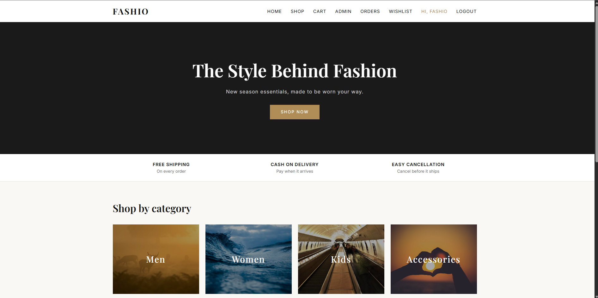
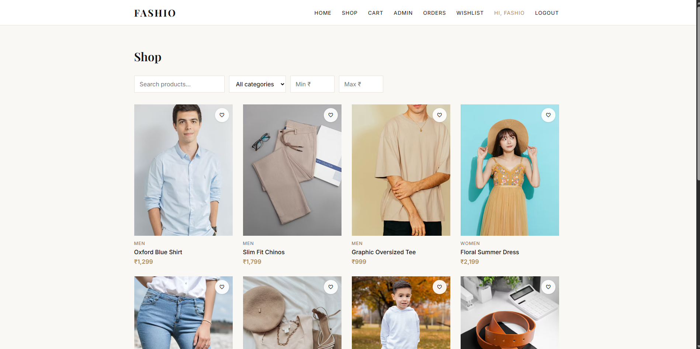
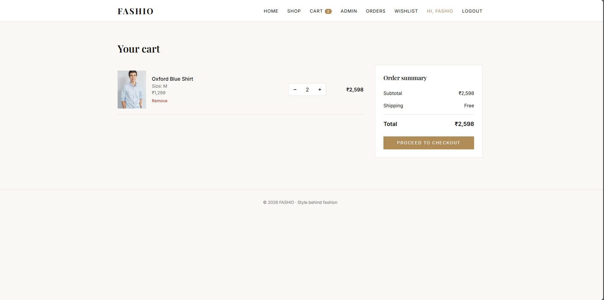
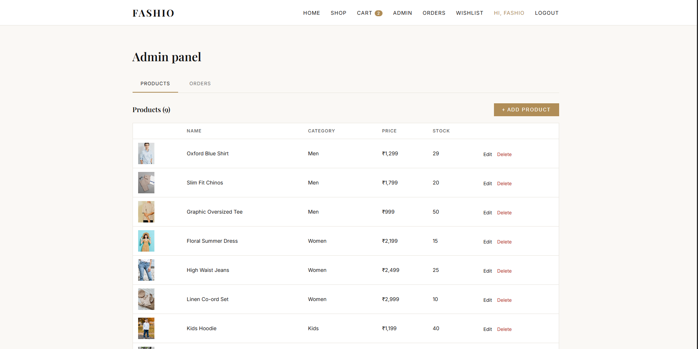
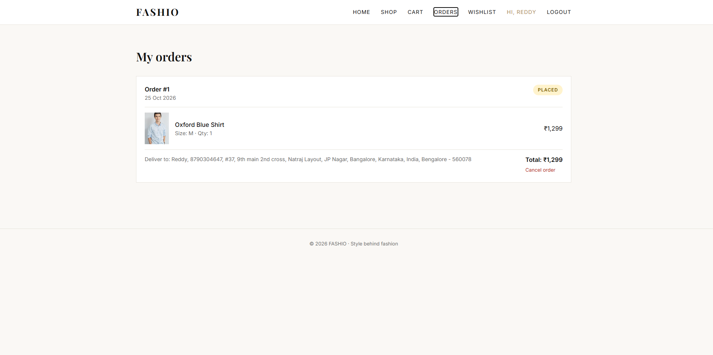

**Live demo:** https://fashio-two.vercel.app
*(The backend runs on a free plan, so the first load after a quiet period can take about a minute.)*

# FASHIO: Style Behind Fashion

A full-stack fashion e-commerce web application built with **React**, **Spring Boot** and **MySQL**.

## Features

**Customer**
- Register and log in (JWT authentication)
- Browse products with search, category and price filters
- Product details with size selection and quantity
- Shopping cart saved in the browser
- Checkout with delivery address (Cash on Delivery)
- Order history and order cancellation (stock is restored)
- Wishlist
- Product reviews and star ratings

**Admin**
- Add, edit and delete products
- View all orders and update their status
- Delete any review

## Tech stack

| Layer | Technology |
|---|---|
| Frontend | React (Vite), React Router, Axios |
| Backend | Java 21, Spring Boot, Spring Security, Spring Data JPA |
| Database | MySQL |
| Auth | JWT (stateless), BCrypt password hashing |

## Project structure

```
fashio-frontend/        React app
fashio-backend/         Spring Boot API
```

## Run locally

### Prerequisites
JDK 17+, Node.js 20+, MySQL 8

### 1. Database
```sql
CREATE DATABASE fashio_db;
```

### 2. Backend
Create `fashio-backend/fashio-backend/src/main/resources/secrets.properties`:
```properties
spring.datasource.password=YOUR_MYSQL_PASSWORD
jwt.secret=ANY_LONG_RANDOM_STRING_OF_32_OR_MORE_CHARACTERS
app.admin.password=CHOOSE_AN_ADMIN_PASSWORD
```

### 3. Frontend
```bash
cd fashio-frontend
npm install
npm run dev
```
Open http://localhost:5173.

### Accounts
**Customer:** register your own account on the live site or locally.
**Admin:** an admin account (`admin@fashio.com`) is created automatically on first start. Its password comes from the `ADMIN_PASSWORD` environment variable. For local development only, it defaults to a development password defined in `application.properties`. The admin panel is shown in the screenshots; contact me if you'd like a walkthrough.

## Configuration (environment variables)

| Variable | Purpose | Default |
|---|---|---|
| `DB_URL` | JDBC URL | local MySQL |
| `DB_USERNAME` / `DB_PASSWORD` | Database login | `root` / empty |
| `JWT_SECRET` | Token signing key (32+ characters) | dev value |
| `CORS_ORIGINS` | Allowed frontend URLs | `http://localhost:5173` |
| `ADMIN_PASSWORD` | Password for the seeded admin | dev-only default (set your own in production) |
| `VITE_API_URL` | Backend URL used by the frontend | `http://localhost:8080/api` |

## API overview

| Method | Endpoint | Access |
|---|---|---|
| POST | `/api/auth/register`, `/api/auth/login` | Public |
| GET | `/api/products`, `/api/products/{id}`, `/api/categories` | Public |
| POST/PUT/DELETE | `/api/products` | Admin |
| POST | `/api/orders` | Logged in |
| GET | `/api/orders/my` | Logged in |
| PUT | `/api/orders/{id}/cancel` | Logged in (own order) |
| GET/PUT | `/api/admin/orders` | Admin |
| GET/POST/DELETE | `/api/wishlist` | Logged in |
| GET | `/api/reviews/product/{id}` | Public |
| POST/DELETE | `/api/reviews/...` | Logged in |

## Screenshots







## Future improvements
- Online payments (Razorpay)
- Image upload
- Email notifications